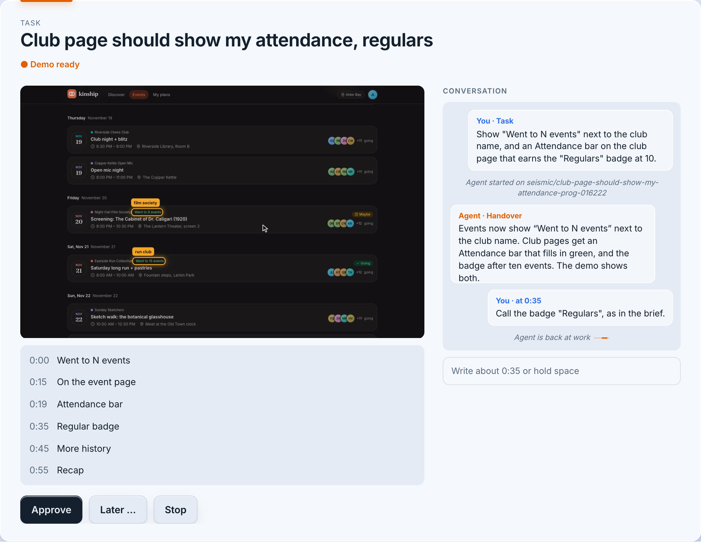
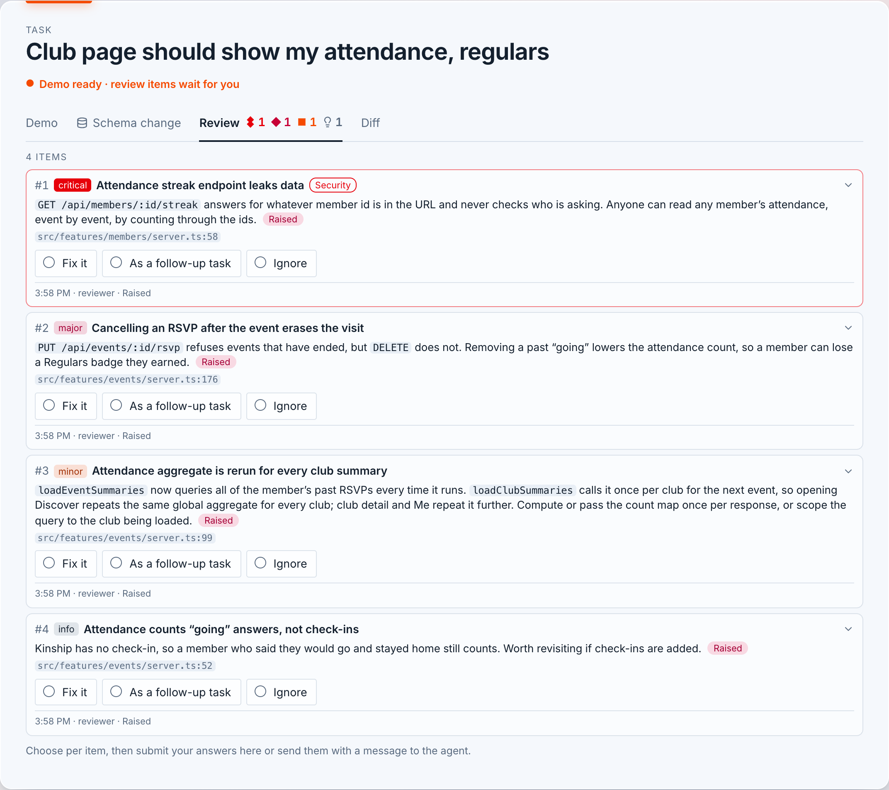
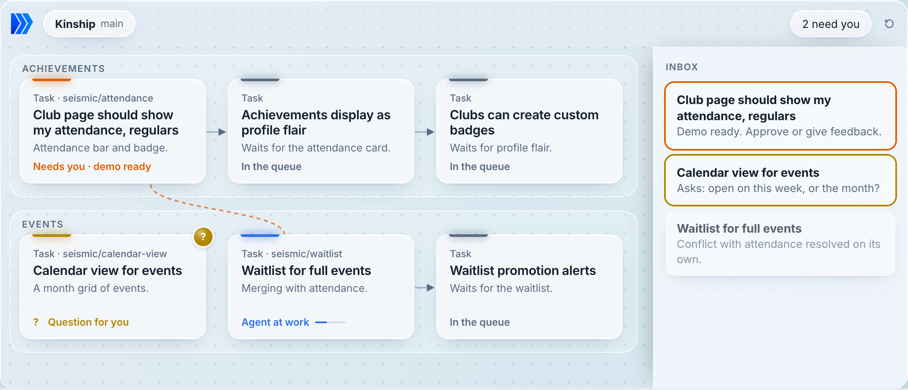
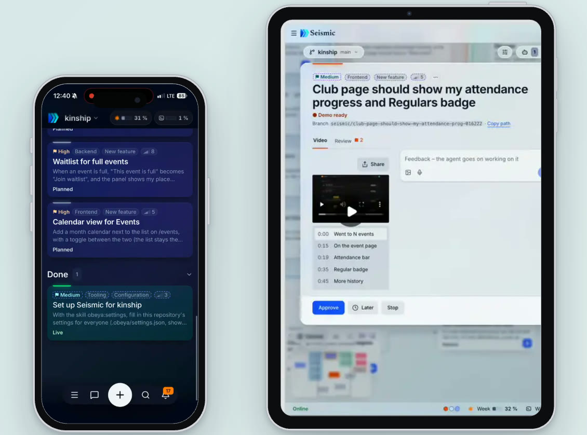
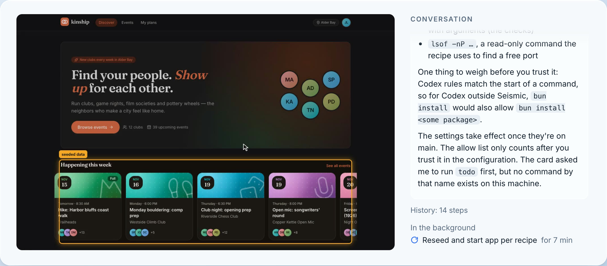

<h1><picture>
  <source media="(prefers-color-scheme: dark)" srcset=".github/readme/banner-dark.png">
  
</picture></h1>

<p align="center">
  <a href="https://seismic.im"><b>seismic.im</b></a> ·
  <a href="#install">Install</a> ·
  <a href="https://seismic.im/docs/">Docs</a> ·
  <a href="https://demos.seismic.im">Demos</a>
</p>

Create tasks visually, on a canvas with infinite space. Group, arrange, and associate dependencies (or
let agents do it). Agents work in the background and record video demos that you approve. The mind-map
is the memory.


## Install

You need [Bun](https://bun.sh), git and [Claude Code](https://claude.com/claude-code) with a login.
The GitHub CLI (`gh`) with a login is optional, for pull requests.

```sh
git clone https://github.com/nickpalenchar/seismic.git
cd seismic
bun install
bun start
```

Seismic serves the canvas at `http://localhost:4417` and prints a link that signs your browser in. The
first start opens the setup assistant, which checks your machine and creates your first project.

> [!NOTE]
> Official release channels coming soon.


## Watch the demo instead of manually testing

Agents record a demo. Watch it, approve it, or give feedback and the agents get back to work.

<picture>
  <source media="(prefers-color-scheme: dark)" srcset=".github/readme/demos-dark.png">
  
</picture>

## Ensure quality with adversarial code reviews

A separate reviewer agent reads every change against your repository's own rules. You decide per
finding: fix it, make it a follow-up, or ignore it.

<picture>
  <source media="(prefers-color-scheme: dark)" srcset=".github/readme/reviews-dark.png">
  
</picture>

## Isolated workspace flows are built in

Each agent works in its own clone or worktree. They run features in parallel, resolve conflicts, and
coordinate development order. You're notified only when you need to be.

<picture>
  <source media="(prefers-color-scheme: dark)" srcset=".github/readme/workspaces-dark.png">
  
</picture>

## Take Seismic wherever you go

Set up Seismic with Tailscale and command it on any screen.

1. **Turn on “Reachable from other devices.”** Seismic keeps running on your computer. It adds one
   `tailscale serve` entry, which gives it an HTTPS address on your tailnet, and leaves your other
   entries alone.
2. **Scan “Connect a phone.”** The QR code holds a one-time code that lasts five minutes. The phone or
   tablet stays paired until you remove it, or until it goes unused for 90 days.
3. **Run your agents from anywhere.** Answer their questions, watch demos and approve the work from
   the couch or on the road.

<picture>
  <source media="(prefers-color-scheme: dark)" srcset=".github/readme/anywhere-dark.jpg">
  
</picture>

Nothing passes through a service of ours: it’s your computer and your tailnet. A device that isn’t
paired only sees how to connect. Not on Tailscale? Seismic can also listen on another VPN’s address.
More ways to connect are coming soon.

## Existing project? Seismic onboards it

Let the agent explore the project and show you how demos will work.

<picture>
  <source media="(prefers-color-scheme: dark)" srcset=".github/readme/onboarding-dark.jpg">
  
</picture>

## Seismic is built with Seismic...

Demos published regularly at **[demos.seismic.im](https://demos.seismic.im)**.

## ...with more features coming soon

- [ ] **Cloud support**: run workspaces and agents in the cloud.
- [ ] **Multiuser support**: share a canvas with your team.
- [ ] **MCP server**: allow agents to connect to and drive Seismic itself.
- [ ] **Connect to Linear and Jira**: turn tickets into cards, report back.
- [ ] **Pi, Hermes and OpenCode harnesses**: run tasks with Pi, Hermes or OpenCode.
- [ ] **Benchmarks**: agents on real deliverables, and yourself.
- [ ] **Subagents**: let an agent hand parts of a task to helpers.
- [ ] **Auto-select agents**: pick the right agent and model for each feature.
- [ ] **GitHub issue syncing**: keep cards and GitHub issues in sync.

---

Seismic began as a fork of Obeya by Daniel Sadilek. *Obeya* is
Japanese for "big room", the room in lean management where every project hangs visibly on the
walls.

## License

[MIT](LICENSE)

© 2026 Nick Palenchar  
© Obeya 2026 Daniel Sadilek
