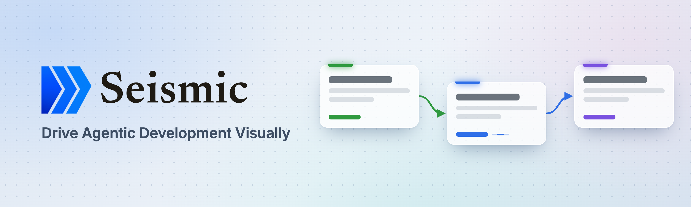
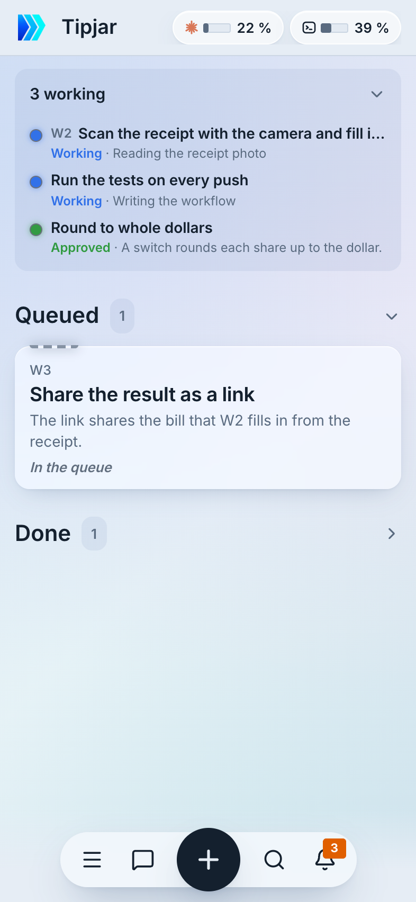
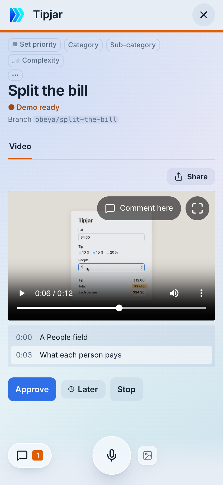

<picture>
  <source media="(prefers-color-scheme: dark)" srcset="site/img/banner-dark.png">
  
</picture>

<!--
Wordmark header, to bring back once the wordmark is updated:
<h1>
  <picture>
    <source media="(prefers-color-scheme: dark)" srcset="src/ui/logo/wordmark-dark.svg">
    
  </picture>
</h1>
-->

A spatial canvas for directing AI coding agents.

New info coming soon. More on [seismic.im](https://seismic.im).

## On your phone

Away from the desk, your phone shows one project at a time: what its agents are working on, what
is queued, and, behind the bell, everything that needs you across all your projects. Watch a demo
and approve it, answer a question, or hold the microphone and say a new task. A notification tells
you when a card needs you.

  
  

To connect a phone: Seismic keeps running on your computer and reaches the phone over your own
private network, Tailscale or another VPN; nothing goes through a service of ours. Turn on
“Reachable from other devices” in Seismic's configuration and scan the code of “Connect a phone”
with the phone.

Seismic began as a fork of Obeya by Daniel Sadilek. *Obeya* is
Japanese for "big room", the room in lean management where every project hangs visibly on the
walls.

## License

[MIT](LICENSE)

© 2026 Nick Palenchar  
© Obeya 2026 Daniel Sadilek
